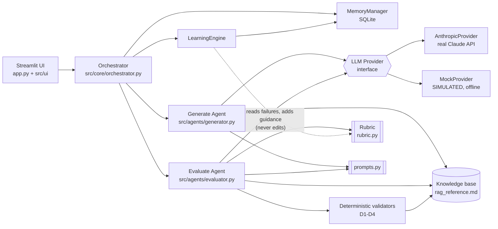
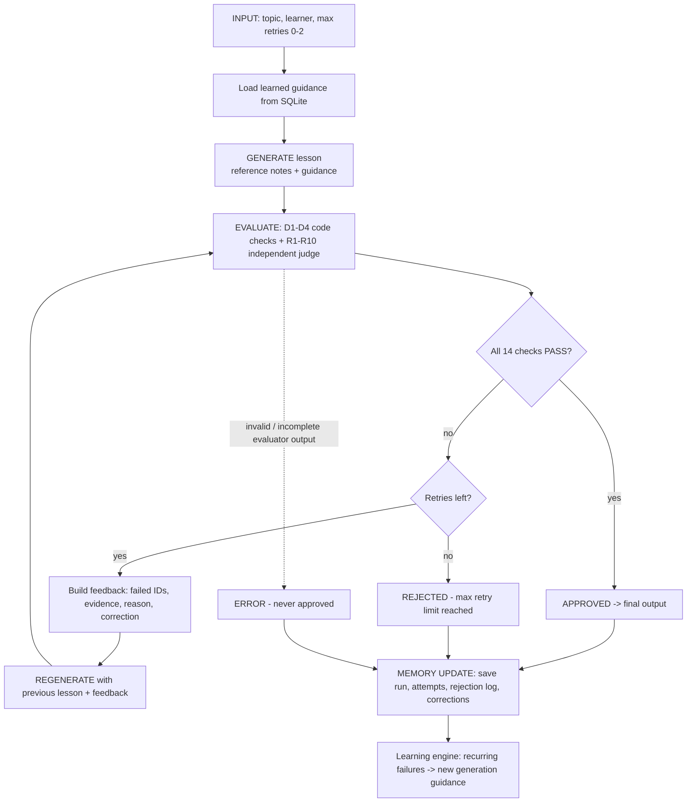

# Architecture

## Component diagram

## Workflow diagram

## Responsibilities
| Module | Responsibility | Does NOT do |
|---|---|---|
| `agents/generator.py` | Builds the prompt (reference notes, guidance, feedback) and returns lesson Markdown | Judge quality |
| `agents/evaluator.py` | Runs D1–D4, asks the judge for R1–R10, validates and enforces the response | Write lessons |
| `core/orchestrator.py` | Bounded retry loop, feedback, rejection log, final status, persistence | Contain prompts or SQL |
| `core/rubric.py`, `core/prompts.py` | Rubric definition; all prompt text and versions | Runtime logic |
| `memory/*` | SQLite schema, run storage, statistics, recurring-failure analysis, guidance | Change the rubric |
| `providers/*` | One interface (`complete(system, user, task)`); Claude and mock implementations | Know about rubric or memory |
| `utils/validators.py` | Deterministic checks | LLM calls |
| `ui/render.py`, `app.py` | Display and exports | Business logic |

## Database tables
`runs`, `attempts`, `check_results`, `corrections`, `learned_guidance` (unique per checkpoint, insert-only), `prompt_versions`, `rubric_versions`, `user_feedback`.
Mock and real runs use **separate DB files** (`memory_mock.db`, `memory_real.db`) so simulated failures never teach real runs.
